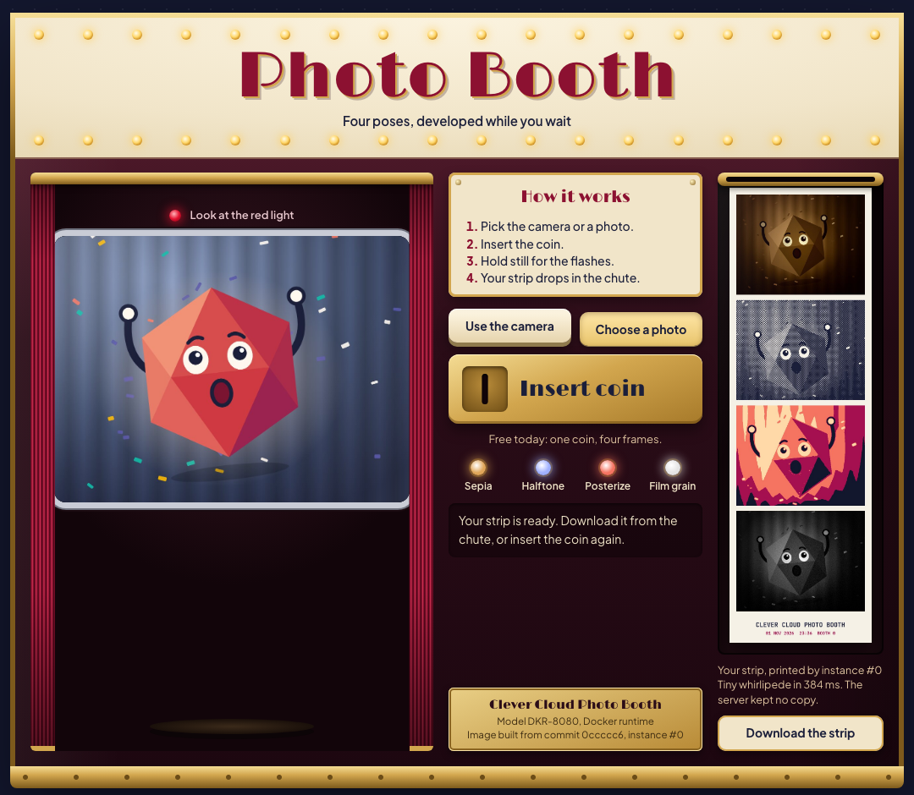
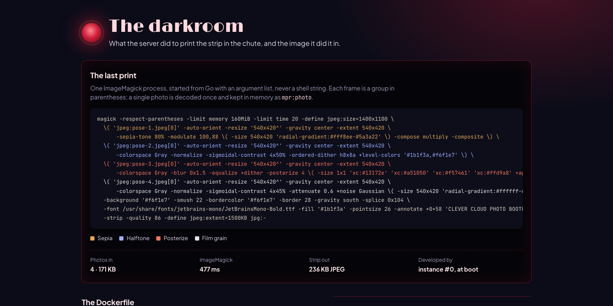

# The Photo Booth: ImageMagick in a Docker image, on Clever Cloud

> A vintage photo booth in the browser. Step behind the red curtain, take four poses with your webcam (or pick one photo), insert the coin, and a Go server prints a 4-frame strip in sepia, halftone, posterize and film grain. The printing is done by **ImageMagick 7, installed in the app's own Docker image**: the **Clever Cloud Docker runtime** builds the multi-stage Dockerfile and runs it as a non-root user. The strip comes back to you; the server keeps nothing. Dressed in the **Clever Brand Kit**, with the Clever Cloud Academy certification in the footer.




More screenshots: [desktop](docs/screenshot-desk.png), [phone](docs/screenshot-phone.png).

**Run it yourself.** The hosted demo was taken down after the presales review (November 2026). The steps in [Deploy on Clever Cloud](#deploy-on-clever-cloud) recreate it from scratch in about 5 minutes.

**Get certified.** This demo runs on Clever Cloud. To deploy your own apps the same way, get certified at the [Clever Cloud Academy](https://academy.clever.cloud/).

---

## What the Docker runtime does here

Below the booth, **the darkroom** shows the work behind each strip, live:

- **The last print**: the exact `magick` command that produced the strip in the chute, one line per frame, with its timing and sizes. The server starts it with an argument list (`exec.Command`), never a shell string.
- **The Dockerfile**, read from the binary itself (`go:embed`), with a note on each key line: two stages, the Alpine packages, the ImageMagick policy, the non-root `USER`, `EXPOSE 8080`, `CMD`.
- **Image size**, measured by `du` inside each stage while Clever Cloud builds it: about 400 MB for the Go build stage, about 53 MB for the image that ships.
- **Inside the container**: ImageMagick version, Alpine release, process user (uid 10001), and the container memory limit read from the cgroup.
- **Why Docker here**: native runtimes give you the system tools Clever Cloud installs for you; this app wants its own ImageMagick build, coders, font and security policy, pinned in one file.



---

## Deploy on Clever Cloud

You need [clever-tools](https://www.clever.cloud/developers/doc/cli/) (`clever login` done) and the ID of the organisation that will own the resources (`orga_…`, shown in the Console). Run the commands from the repo root: `clever create` links the folder to the new app.

```bash
clever create --type docker demo-docker --region par --org <org_id>
clever scale --min-flavor nano --max-flavor XS --min-instances 1 --max-instances 2
clever scale --build-flavor M                    # the image is built on a dedicated instance
clever env set CC_HEALTH_CHECK_PATH /health      # deployment validated on /health
clever deploy                                    # builds the Dockerfile, then runs it
clever open
```

No add-on, no secret to generate, no setup script: the sample strip is printed at boot from the embedded poses. `GET /health/deep` runs ImageMagick once.

Checked against the [Docker runtime doc](https://www.clever.cloud/developers/doc/deploy/applications/docker/): a `Dockerfile` at the root, a `CMD`, and an app listening on port 8080 (the default `CC_DOCKER_EXPOSED_HTTP_PORT`). With the default ports the container runs in host network mode, so the server listens on `0.0.0.0:8080`. From `clever deploy` to a running app takes under a minute (the image build itself is about 15 s).

---

## Variables

| Variable | Set by | Use |
|---|---|---|
| `PORT` | Clever Cloud (8080) | Port the Go server listens on; 8080 when unset |
| `CC_HEALTH_CHECK_PATH` | you | `/health`, which answers without running ImageMagick |
| `CC_APP_NAME`, `APP_ID`, `INSTANCE_NUMBER`, `INSTANCE_TYPE`, `CC_PRETTY_INSTANCE_NAME`, `CC_COMMIT_ID`, `CC_DEPLOYMENT_ID` | Clever Cloud | Shown in the "Running on Clever Cloud" panel. No other variable is ever read for display |

**No add-on.** The dependency here is a system binary: ImageMagick, installed by the Dockerfile. `GET /health/deep` checks it with a real 16 x 16 render.

---

## Routes

| Route | What it does |
|---|---|
| `GET /` | The booth and the darkroom |
| `POST /api/strip` | 1 or 4 photos in the multipart field `photo`; answers the strip as `image/jpeg`, with `X-Magick-Command` (base64), `X-Magick-Ms`, `X-Developed-By` |
| `GET /sample-strip.jpg` | The sample strip printed at boot from the 4 embedded poses, so the chute is never empty |
| `GET /health` | `ok`, touches nothing |
| `GET /health/deep` | Runs ImageMagick once, returns its version and timing |

Try it from a terminal:

```bash
curl -F photo=@me.jpg https://<your-app>.cleverapps.io/api/strip -o strip.jpg
```

---

## Safety and limits

- **Uploads**: 8 MB in total, 1 or 4 files, sniffed by content (JPEG, PNG, WebP, GIF). SVG, MVG and anything else is refused before ImageMagick runs. Pixel count is checked from the header: 50 MP for JPEG (decoded downscaled with `jpeg:size`), 20 MP for other formats.
- **ImageMagick**: each input gets a forced coder (`jpeg:pose-1.jpeg[0]`), first frame only. `imagemagick/policy.xml` replaces the image default: only JPEG, PNG, WebP, GIF and the built-in canvases, no delegates, no `@file` reads, 192 MiB memory, 2 threads.
- **Processing**: one strip at a time (a nano instance has under 300 MiB), 25 s timeout, output capped at 3 MB (`jpeg:extent=1500KB` plus a hard cap in Go). EXIF data, GPS included, is stripped.
- **Storage**: inputs live in a private temp folder deleted after the command; the strip only exists in the HTTP response.
- **Page**: strict CSP (no inline script or style), camera allowed for the page itself only.

---

## Code tour

```
main.go            HTTP server, routes, upload validation, sample strip at boot, security headers
booth.go           the strip: ImageMagick recipes per frame, argument list, run with timeout and caps
platform.go        Clever platform variables (allow-list), container facts, Dockerfile annotations
main_test.go       tests: health, variable allow-list, refusals, argument list, end-to-end strip, policy
Dockerfile         two stages: golang:1.27-alpine3.24 builds, alpine:3.24 + ImageMagick ships
imagemagick/       policy.xml copied over the image default
static/            page template, booth.css, app.js (camera, countdown, flash), brand kit, sample poses
```

Standard library only. The sample poses are the Clever gem drawn as an SVG character for this demo.

---

## Local development

```bash
brew install imagemagick                         # ImageMagick 7
MAGICK_CONFIGURE_PATH=$PWD/imagemagick PORT=8461 go run .    # same policy as the image
go test ./...                                    # ImageMagick tests are skipped if magick is missing
docker build -t photo-booth . && docker run -p 8080:8080 photo-booth   # or the real image
```

Requires Go 1.27+. The caption font is JetBrains Mono Bold; without it, the strip is printed without caption. The camera needs HTTPS or `localhost`.

---

MIT License. Source: https://github.com/Vitiosum/demo-docker
